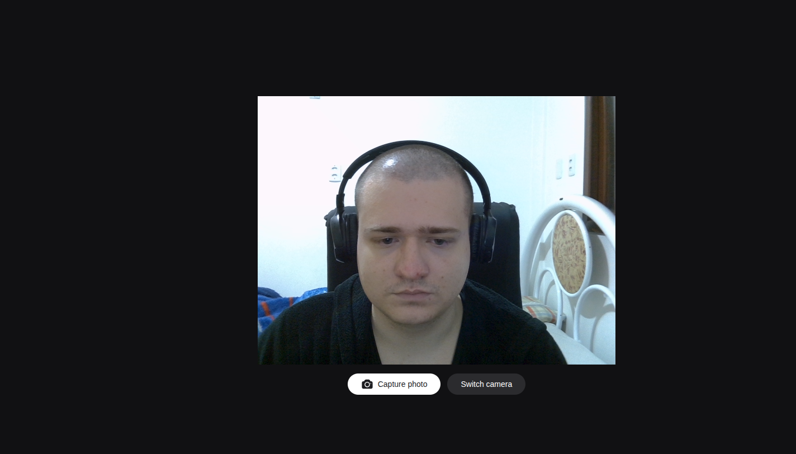

# Online Camera

A tiny, privacy-first webcam app that runs entirely in your browser. Open the page, allow camera access, and capture a photo that downloads straight to your device.

**Live demo:** [online-camera.vercel.app](https://online-camera.vercel.app)



## Features

- Live webcam preview in the browser, with no install and no account
- One-click photo capture that downloads directly to your device
- Switch between front and back cameras
- Friendly, actionable error messages when the camera is unavailable or access is denied
- Fully client-side: nothing is uploaded and there is no backend

## Privacy

Camera frames never leave your device. There is no API layer and no server-side storage: the photo is generated in the browser and saved locally through a download.

## Tech stack

- [Next.js 16](https://nextjs.org) (App Router) and [React 19](https://react.dev)
- [TypeScript](https://www.typescriptlang.org)
- [Tailwind CSS v4](https://tailwindcss.com)
- [`@shivantra/react-web-camera`](https://www.npmjs.com/package/@shivantra/react-web-camera) for camera access
- Jest and React Testing Library for unit tests

## Getting started

Requirements: Node.js 20+ and npm.

```bash
npm install
npm run dev
```

Open [http://localhost:3000](http://localhost:3000) and allow camera access when prompted. Browsers only expose the camera on `localhost` or over HTTPS.

## Scripts

| Command             | Description                      |
| ------------------- | -------------------------------- |
| `npm run dev`       | Start the development server     |
| `npm run build`     | Create a production build        |
| `npm start`         | Serve the production build       |
| `npm run lint`      | Run ESLint                       |
| `npm run typecheck` | Run the TypeScript type-check    |
| `npm test`          | Run unit tests (Jest + RTL)      |

## Project structure

```
src/
├── app/         # App Router: page, layout, global styles and design tokens
├── components/  # CameraView, CameraIcon, ErrorBoundary
├── hooks/       # useCameraCapture: camera ref, capture/switch actions, error state
└── services/    # logger, analytics, crashReporter, fileDownload
```

Path aliases (`@components/*`, `@hooks/*`, `@services/*`) are configured in `tsconfig.json` and `jest.config.mjs`.

## Deployment

The app is hosted on [Vercel](https://vercel.com) at [online-camera.vercel.app](https://online-camera.vercel.app). Being a standard Next.js project, it needs no extra configuration to deploy there.
